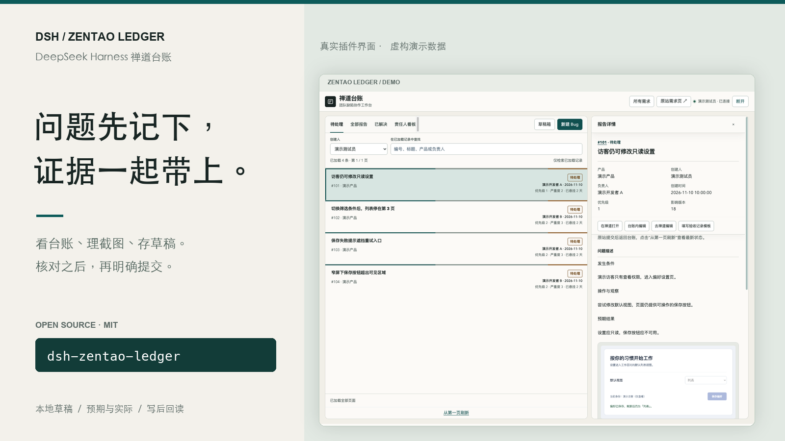
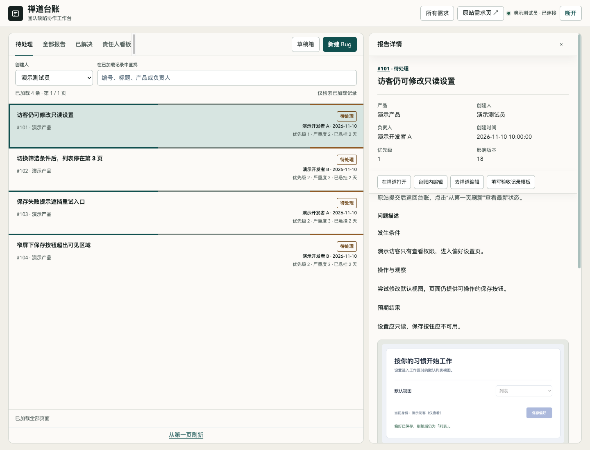
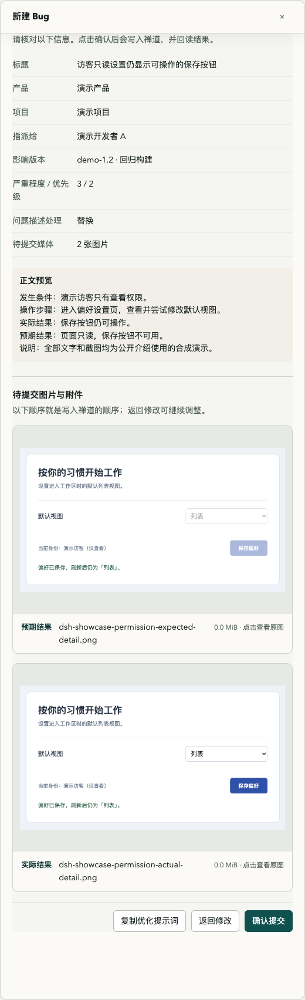
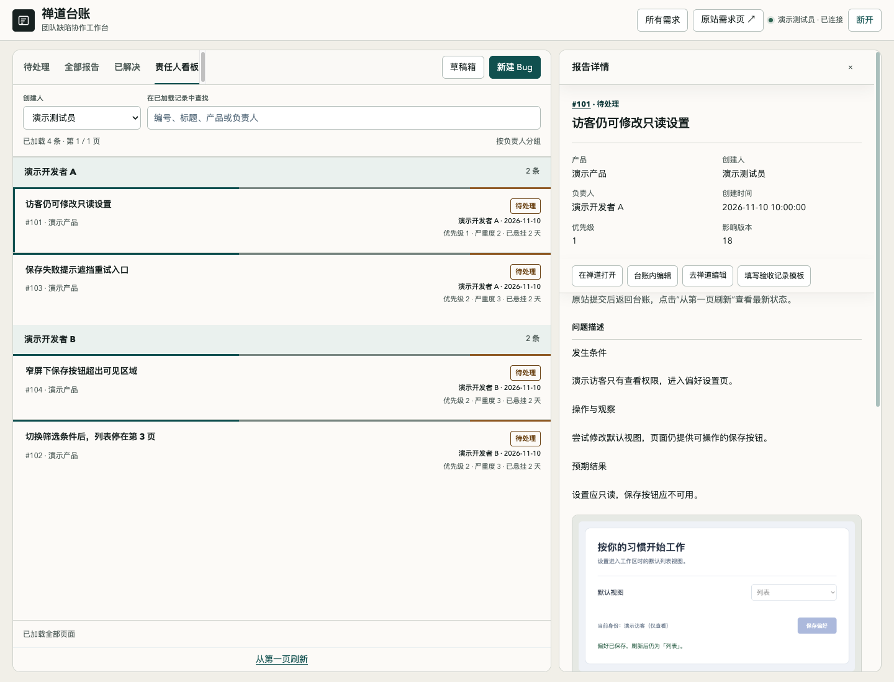

# DSH ZenTao Ledger

**Keep the Bug, its evidence, and your unfinished draft together.**

[简体中文](README.zh-CN.md) · [Releases](https://github.com/lichufeng123/dsh-zentao-ledger/releases) · [Configuration](docs/configuration.md) · [Contributing](CONTRIBUTING.md)

A ZenTao ledger inside DeepSeek Harness for QA and developers. Read Bug lists, details and history; organize expected and actual screenshots; save drafts when another issue interrupts; review before explicitly submitting a change.

Targets DSH **>=0.2.2-rc.1** and Node.js **>=22**. MIT licensed. The interface currently uses Simplified Chinese. This independent public package has its own identity and storage namespace.

> Screenshots use the actual plugin code in an isolated demo adapter with entirely synthetic records, accounts and images. They are not a real customer session, production test or full DSH Desktop integration result.

## Keep daily triage in view

Switch among active Bugs, all reports, resolved Bugs and an assignee board. Open descriptions, history and same-site evidence without losing your place, with links back to ZenTao. Search covers loaded pages; pagination and remaining-page indicators make that boundary visible.



## Prepare evidence before the write

Separate expected and actual screenshots, paste and reorder images, and preview the final groups. Videos remain attachments. Draft text and selected media persist locally. Stash the current draft to handle an interruption, then return to it. The review screen shows associations, affected builds and media before an explicit submission.



## Follow owners and retain context

The assignee board groups active Bugs. Details retain actors, resolutions and comments. Compatible resolved Bugs can be closed through a per-Bug confirmation followed by state/history readback. A template or a close action does not establish that acceptance testing happened.



## Install and connect

Download an archive from [Releases](https://github.com/lichufeng123/dsh-zentao-ledger/releases), or install source into the DSH CLI profile you actually use:

```sh
dsh plugin --profile web add github:lichufeng123/dsh-zentao-ledger
```

Replace `web` with your ordinary CLI profile. For a Desktop-managed profile, use the application's plugin installer; a CLI profile named `desktop` is not automatically its managed profile. The intended npm package is `dsh-zentao-ledger`; consult the registry and release page for its current availability.

Configure your own site and associations in the active profile's Cordis patch. Every value below is an example:

```yaml
- id: dsh-zentao-ledger
  config:
    origin: https://zentao.example
    productId: '3'
    projectId: '9'
    authMode: token
```

Open **禅道台账**, enter your own supported authorization and connect. The Host verifies the returned account/user ID and stores credentials through DSH's local credentials service. Status exposes identity, not secrets. There is no preconfigured company origin, product, user or assignee exclusion list.

**Check compatibility first.** Version `0.1.0` targets classic ZenTao JSON and web-form contracts, not every ZenTao version. Token mode requires the site's `/user-login.html?token=…` exchange; a REST API token is not necessarily accepted. Cookie mode supports an existing authenticated web session but does not convert a session cookie into a REST upload token. Media operations stop if upload authorization cannot be established. Root-origin deployment, product requirements, form parsing and related limits are documented in [Configuration](docs/configuration.md).

## Optional AI, explicit submission

AI assistance is **off by default**. Configure your own DSH provider and model to enable it. Clicking optimization sends draft text and up to six bounded images with expected/actual roles to that provider; video is excluded. The output remains a suggestion you must review and apply. It neither submits a Bug nor turns an inference into an observed fact.

## Reconcile an uncertain result

The Host verifies identity, metadata and associations at the write boundary, then reads back the actual saved fields. A returned ID without matching readback remains pending; only read-only reconciliation is offered. Unknown writes are not silently repeated. The duplicate-write guard is process-local, so check ZenTao independently before repeating an uncertain operation after a Host restart.

The plugin does not execute tests, establish acceptance, synchronize Notion or notify developers. Access to create, edit, upload and close remains controlled by your own ZenTao deployment.

[Security and data boundaries](SECURITY.md) · [Configuration](docs/configuration.md) · [Development](CONTRIBUTING.md) · [Changelog](CHANGELOG.md) · [MIT License](LICENSE)
