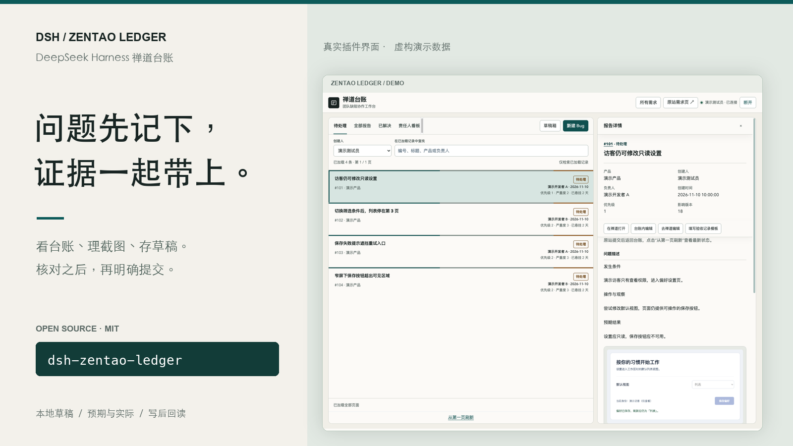
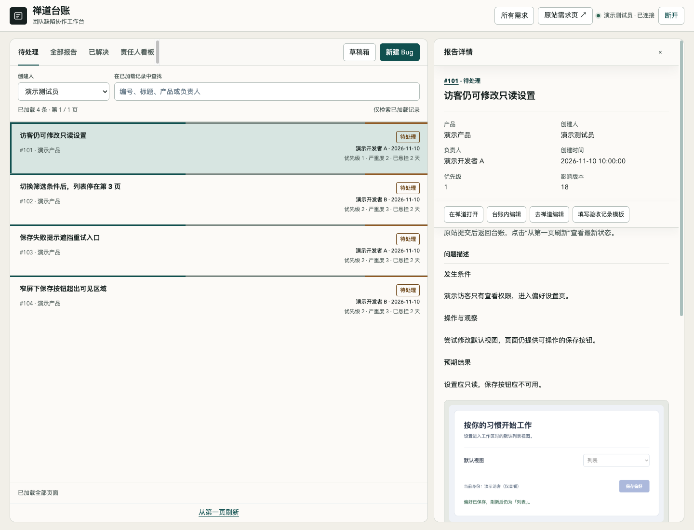
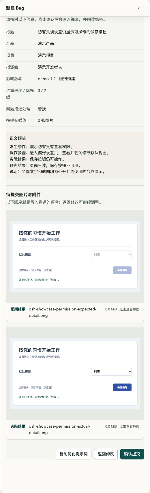
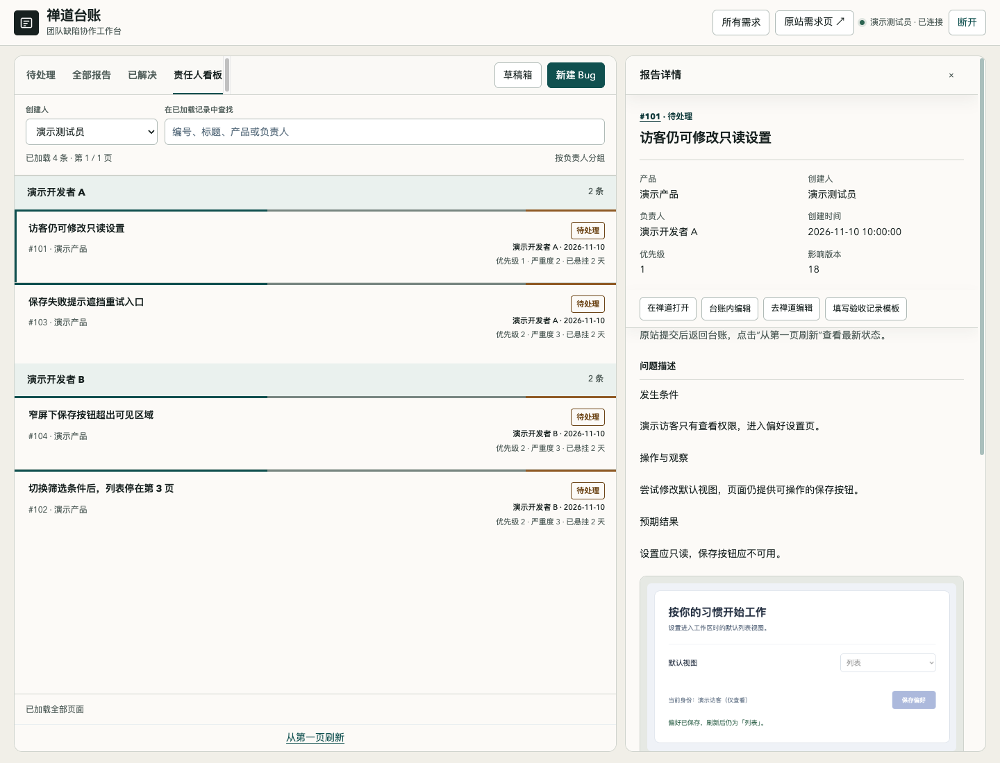

# DSH 禅道台账

**看台账、理截图、存草稿，在同一个侧栏里完成。**

[English](README.md) · [发布版本](https://github.com/lichufeng123/dsh-zentao-ledger/releases) · [配置与兼容性](docs/configuration.md) · [参与贡献](CONTRIBUTING.md)

给使用 DeepSeek Harness 的测试人员与研发：集中查看禅道 Bug 的状态、负责人、描述和历史；把预期与实际截图整理进草稿，核对后再明确提交。紧急问题插进来，也能先把手上的内容存好，稍后继续。

面向 DSH **>=0.2.2-rc.1**、Node.js **>=22**，采用 MIT 许可证。界面当前使用简体中文。公开版拥有独立包名和存储空间，与原有私有插件分别安装。

> 图片展示真实插件代码在隔离演示环境中的界面，数据、账号与图片均为虚构示例；不连接任何公司的禅道，也不代表真实生产验收结果。

## 一份列表，接住每天的缺陷跟进

在待处理、全部报告、已解决和责任人看板之间切换；查看正文、历史记录与同站点图片，保留原站处理入口。搜索只覆盖已加载的页面，加载进度和剩余页数会明确显示，避免把半份列表当成全部。



## 证据先整理，提交前再看一遍

预期截图与实际截图分开整理，可以粘贴、排序和预览；视频作为附件。文字与媒体草稿保存在本机，临时插入另一条 Bug 时，可先存入草稿箱。最终核对页会展示标题、归属、影响版本及待提交媒体，明确点击后才向禅道写入。



## 按负责人看待办，沿历史找上下文

责任人看板只分组待处理 Bug。打开具体记录后，可以查看谁创建、谁处理以及解决方案和备注。兼容的已解决 Bug 可通过单条确认关闭，写后回读状态与历史；模板草稿和“验收后关闭”都不等于插件替你执行了验收。



## 安装与第一次连接

从 [GitHub 发布页](https://github.com/lichufeng123/dsh-zentao-ledger/releases)下载安装包，或安装公开源码到实际使用的 CLI profile：

```sh
dsh plugin --profile web add github:lichufeng123/dsh-zentao-ledger
```

将 `web` 换成自己的普通 CLI profile。桌面应用请使用其插件安装器；CLI 中名为 `desktop` 的 profile 不自动等于桌面应用内部管理的 profile。公开 npm 包名为 `dsh-zentao-ledger`，npm 可用状态以发布页和注册表为准。

在当前 profile 的 Cordis patch 中设置自己的站点和归属。编号和名称都是示例，需要换成你有权访问的实际值：

```yaml
- id: dsh-zentao-ledger
  config:
    origin: https://zentao.example
    productId: '3'
    projectId: '9'
    authMode: token
```

打开侧栏 **禅道台账**，按选定方式输入自己的授权并连接。插件会核对站点返回的账号和用户编号，把授权交给 DSH 本机凭据服务保存，界面只显示身份与连接状态。没有预置账号、站点、产品或人员名单。

**先核对兼容性。** `0.1.0` 对接经典禅道 JSON 路由与网页表单，不承诺任意禅道版本都能直接使用。令牌模式需要站点支持 `/user-login.html?token=…` 会话交换；普通 REST Token 不一定适用。Cookie 模式可使用自己的既有网页会话，但不会把 Cookie 冒充 REST 文件上传 Token；无法核对文件授权时会停止附件上传。根路径部署、接口格式、需求查询与关闭表单的限制见[配置说明](docs/configuration.md)。

## AI 只提供建议，提交仍由你确认

AI 描述优化 **默认关闭**。需要时配置自己的 DSH 提供商与模型；明确点击后，它会读取草稿文字和最多六张受限图片，区分预期与实际，返回可审阅的建议。视频不会发送给模型。应用建议不自动创建 Bug，仍需人工检查并提交；不能把 AI 推测当成实测结果。

## 一次提交，回读后才算确认

新建、编辑和关闭前核对身份、记录及产品项目，提交后读取实际保存结果。已获得编号但回读不一致时，保留核对状态，仅允许只读检查；结果未知时不自动重发。重复写入保护目前在宿主进程内生效，重启后遇到未知结果仍须先查原站。

本插件不会自动运行测试、创建外部验收结论、同步 Notion 或发送研发通知。用户是否有权创建、编辑、上传和关闭，仍由自己的禅道部署决定。

[安全与数据边界](SECURITY.md) · [配置及兼容性](docs/configuration.md) · [贡献与本地检查](CONTRIBUTING.md) · [变更记录](CHANGELOG.md) · [MIT 许可](LICENSE)
